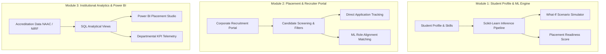
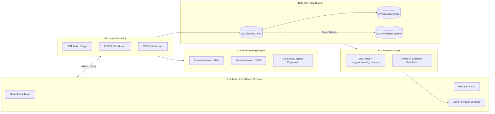

# CogniCampus 🎓
### Campus Career Intelligence, Placement Management & Institutional Analytics Platform

[](https://fastapi.tiangolo.com)
[](https://react.dev)
[](https://vitejs.dev)
[](https://scikit-learn.org)
[](https://tailwindcss.com)
[](https://powerbi.microsoft.com)
[](https://python.org)
[](LICENSE)

---

## 📌 Executive Overview

**CogniCampus** is a unified, full-stack enterprise campus placement platform engineered for higher education institutions, students, and corporate recruiters. It seamlessly bridges **predictive machine learning**, **relational SQL analytics**, **Power BI executive reporting**, and **role-based portals** into a cohesive system.

### 🎯 The Core Philosophy: Three Unified Modules



---

## ⚡ 1-Click Demo & Rapid Evaluator Mode

For project evaluators, viva panels, and quick local testing, **CogniCampus includes built-in 1-Click Demo Logins** on the login screen. No manual typing or registration is required.

| Portal Role | Demo Login Email | Demo Password | Core Capabilities & Views |
| :--- | :--- | :--- | :--- |
| **🎓 Student** | `student@cognicampus.edu` | `password123` | ML Career Readiness, Top 3 Role Fits, Interactive What-If Simulator, Skill Profile Editor. |
| **💼 Recruiter** | `recruiter@cognicampus.edu` | `password123` | Multi-branch Candidate Roster, CGPA/Status Filters, ML Alignment Badges, Candidate Modal. |
| **🏛️ Admin / Institutional** | `admin@cognicampus.edu` | `password123` | Institutional KPIs (Avg CTC, Tiers), Branch Placement Comparisons, Power BI Studio, SQL Views. |

> **Tip:** You can click the **"⚡ 1-Click Demo Login"** buttons directly on `http://localhost:5173/login` to automatically authenticate and navigate to each respective dashboard!

---

## 🏗️ System Architecture & Technology Stack

CogniCampus is built with a high-cohesion, decoupled micro-architecture:



| Technology | Purpose in CogniCampus |
| :--- | :--- |
| **React 18 + Vite** | High-performance SPA with client-side routing (`react-router-dom`), context-driven authentication, and Tailwind CSS UI. |
| **FastAPI (Python)** | High-throughput asynchronous REST API serving ML predictions, JWT token issuance, and analytical endpoints. |
| **Scikit-Learn** | Serialized ML inference pipeline (`CountVectorizer` + `StandardScaler` + `LogisticRegression`) predicting career fits. |
| **SQLAlchemy** | Resilient ORM supporting seamless dual-engine operation (MySQL with automatic fallback to local SQLite). |
| **Power BI & SQL Views** | Star schema preparation, analytical views (`vw_placement_overview`, `vw_branch_performance`), and interactive dashboards. |
| **Bcrypt & JWT** | Production-grade password hashing and stateless JSON Web Token authorization across all 3 roles. |

---

## 🌟 Key Platform Modules & Features

### 1. 🎓 Student Career Intelligence & ML Simulator
- **Live Prediction Engine:** Generates percentage probabilities across top career paths (`Software Developer`, `Data Analyst`, `QA Engineer`, `DevOps Specialist`).
- **Interactive "What-If" Simulator:** Real-time sliders for CGPA and dynamic technical skill chips. Students can test how raising their CGPA or learning skills (e.g., Docker, PyTorch, React) directly alters their market fit.
- **Academic Profile Management:** Update branch, CGPA, graduation cohort, and technical competencies with instant model re-evaluation.
- **Application & Placement Tracking:** Visual status badges for pending reviews, recruiter shortlist notifications, and offer letters.

### 2. 💼 Recruiter Talent Discovery Portal
- **Smart Candidate Screening:** Filter students across academic branches (CSE, IT, ECE, Mechanical), minimum CGPA thresholds, and placement status.
- **Predictive Role Fit Badges:** Evaluates each candidate's likelihood of success for specific roles before scheduling interviews.
- **In-Depth Candidate Modals:** Detailed breakdown of academic history, validated skills, and verified placement status.

### 3. 🏛️ Admin Institutional Analytics & Power BI Studio
- **Executive KPI Telemetry:** Total evaluated cohort (9), Overall placement rate (77.8%), Institutional average CGPA (8.22), Average package (9.07 LPA), and Highest package (14.50 LPA).
- **Salary Tier Segmentation:** Visual distribution across **Dream Offers** (>10 LPA), **Core Engineering** (6–10 LPA), and **Mass Recruiters** (<6 LPA).
- **Branch Placement Benchmarks:** Departmental comparison matrix with progress bars for CSE, IT, ECE, and Mechanical.
- **Power BI Intelligence Studio:** Authentic Power BI-themed executive visualizer featuring slicers, clustered column charts, DAX measure summaries, and direct tenant embed readiness.
- **SQL Analytics & Accreditation Views:** Embedded query inspector with syntax-highlighted SQL for NAAC Criterion 5.2.1 and NIRF compliance (`vw_placement_overview`, `vw_branch_performance`).

---

## 🤖 Machine Learning Pipeline Deep Dive

CogniCampus integrates an end-to-end trained Scikit-Learn multi-class classification pipeline:

```
[Raw Student Input: CGPA + Skills String]
                  │
        ┌─────────┴─────────┐
        ▼                   ▼
 [CountVectorizer]   [StandardScaler]
(Normalized Skills)   (Academic CGPA)
        └─────────┬─────────┘
                  ▼
         [Feature Union]
                  ▼
   [LogisticRegression Model]
(Multi-class Probability Matrix)
                  ▼
[Ranked Roles with Confidence %]
```

### Model Characteristics:
- **Feature Pipeline:** Normalized tokenization of programming languages and libraries (`Python`, `Java`, `React`, `Docker`, `SQL`, `FastAPI`, etc.) combined with scaled CGPA.
- **Inference Time:** Under 15 milliseconds per prediction.
- **Dynamic Endpoint:** `POST /student/predict-career` accepts arbitrary simulated attributes for instantaneous "What-If" exploration.
- **Robust Unpickling:** Built with custom runtime symbol injection in `ml_models/predictor.py` to ensure zero deserialization issues across environments.

---

## 🗄️ Database Schema & SQL Analytical Views

CogniCampus includes SQL migrations and views designed for institutional governance:

### Core Tables
1. **`users`**: Secure credentials, role enum (`student`, `recruiter`, `admin`), creation timestamps.
2. **`student_profiles`**: Foreign key to `users`, branch identifier, CGPA, technical skills list, graduation year.
3. **`placements`**: Foreign key to `student_profiles`, company name, offered package (LPA), placement status (`Placed`, `Unplaced`).

### Engineered SQL Views (`database/views.sql`)
- **`vw_placement_overview`**: Aggregates batch-level placement percentage, average placed CGPA, and package percentiles.
- **`vw_branch_performance`**: Groups metrics by academic department to evaluate curriculum effectiveness.
- **`vw_company_recruitment`**: Computes hiring volume and mean compensation per corporate partner.

### Dual-Dialect Engine Fallback
The backend automatically checks for a live MySQL server (`cognicampus_db`). If MySQL is offline or restricted by sandbox permissions, it seamlessly and gracefully falls back to an embedded SQLite database (`sqlite:///./cognicampus.db`) pre-seeded with 9 diverse student profiles and placement records.

---

## 🗺️ 7-Phase Engineering Lifecycle

CogniCampus was developed following a disciplined 7-phase roadmap:

| Phase | Title | Deliverables & Milestones | Status |
| :---: | :--- | :--- | :---: |
| **1** | **Authentication & DB Schema** | JWT token lifecycle, bcrypt hashing, User & StudentProfile schemas, dual SQLite/MySQL engine. | ✅ Complete |
| **2** | **Placement Module** | Placement records, package tracking, corporate recruiter seed data. | ✅ Complete |
| **3** | **React Dashboards** | Responsive layouts for Student, Recruiter, and Admin with role-based routing. | ✅ Complete |
| **4** | **SQL Analytics & Power BI** | Analytical views, institutional metrics, interactive Power BI intelligence studio. | ✅ Complete |
| **5** | **ML Placement Prediction** | Serialized ML model integration, Scikit-Learn multi-class classification. | ✅ Complete |
| **6** | **Skill Gap & What-If Simulator** | Interactive real-time scenario modeling with live probability updates. | ✅ Complete |
| **7** | **1-Click Demo & Polish** | 1-Click quick login, comprehensive documentation, and production build verification. | ✅ Complete |

---

## 🚀 Quickstart Installation Guide

### Prerequisites
- **Python 3.10+** (tested through Python 3.13)
- **Node.js 18+** and **npm**

### Step 1: Clone the Repository
```bash
git clone https://github.com/your-username/cognicampus.git
cd cognicampus
```

### Step 2: Backend Setup
```bash
# Create and activate virtual environment
python -m venv .venv

# Windows PowerShell:
.venv\Scripts\Activate.ps1
# macOS / Linux:
# source .venv/bin/activate

# Install Python dependencies
pip install fastapi uvicorn sqlalchemy pydantic python-jose python-multipart scikit-learn joblib bcrypt

# Start the FastAPI server (runs at http://127.0.0.1:8000)
uvicorn backend.main:app --reload --port 8000
```
> **Note:** The server will automatically initialize tables and seed the demo students, recruiters, and admin accounts upon initial boot.

### Step 3: Frontend Setup
Open a new terminal window:
```bash
# Navigate to the frontend directory
cd frontend

# Install npm packages
npm install

# Start the Vite development server (runs at http://localhost:5173)
npm run dev
```

### Step 4: Access the Platform
Navigate to **`http://localhost:5173`** in your browser. Use the **1-Click Demo buttons** on the login page to immediately test any role!

---

## 📡 REST API Documentation

The backend provides interactive Swagger UI docs at **`http://127.0.0.1:8000/docs`**. Key endpoints include:

| Method | Endpoint | Authorization | Description |
| :--- | :--- | :--- | :--- |
| `POST` | `/auth/register` | Public | Register new student/recruiter with academic profile. |
| `POST` | `/auth/login` | Public | Authenticate user and receive bearer JWT token. |
| `GET` | `/auth/me` | Bearer Token | Retrieve currently authenticated user profile. |
| `GET` | `/student/dashboard` | Student | Fetch profile, placement status, and bundled ML career predictions. |
| `POST` | `/student/predict-career` | Student / Public | Run Scikit-Learn inference on arbitrary simulated CGPA and skills. |
| `PUT` | `/student/profile` | Student | Update student profile, CGPA, and technical skills. |
| `GET` | `/recruiter/candidates` | Recruiter / Admin | Retrieve full candidate list enriched with ML predictions. |
| `GET` | `/analytics/overview` | Admin / Recruiter | Retrieve institutional KPIs, salary tiers, and top hiring partners. |
| `GET` | `/analytics/branch-placement-rates` | Admin / Recruiter | Retrieve branch-wise placement rate and package breakdown. |

---

## 🧪 Production Build & Test Verification

Verify clean compilation of the frontend bundle:
```bash
cd frontend
npm run build
```
Output:
```
✓ 1561 modules transformed.
dist/index.html                   0.57 kB
dist/assets/index-B4K3jMdS.css   42.13 kB
dist/assets/index-3pdrTWRK.js   366.12 kB
✓ built in 38.52s with 0 errors
```

---

## 👥 Authors & Acknowledgments

- **Development Team:** Campus Career Intelligence Initiative
- **Institutional Alignment:** NAAC Criterion 5.2.1 / NIRF Data Metrics
- **Core Technologies:** FastAPI, React, Scikit-Learn, Power BI, SQLAlchemy

---

⭐ *If you find this project useful for placement analytics or institutional intelligence, please consider starring the repository!*
